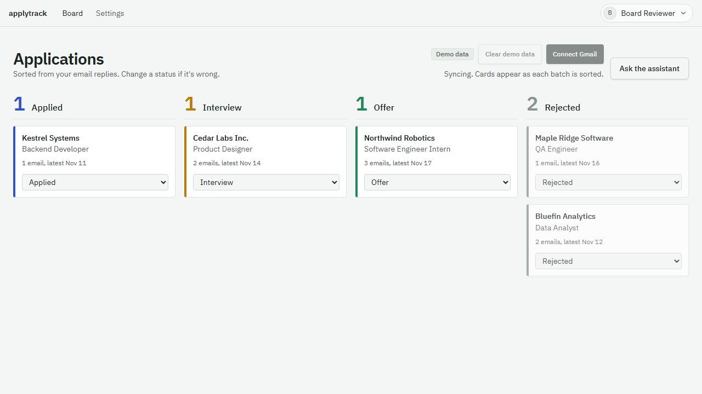

# applytrack

A job application tracker built on [DeepSpace](https://docs.deep.space). It reads your Gmail (read-only), uses AI to sort job-related emails into a live board (Applied, Interview, Offer, Rejected) with an email timeline per application. An assistant answers questions about your search and can propose a status change, which only happens when you click Confirm.

**Live:** https://applytrack.app.space. Use **Try with demo data** on the board to try it without connecting Gmail.

Gmail sync needs DeepSpace credits. Reviewers can try everything with demo data.



## DeepSpace features used

- **Platform auth** for sign-in. No custom auth or sessions.
- **Google integration** (`google/gmail-inbox`, user-billed, read-only) for Gmail.
- **RecordRoom collections** with per-user RBAC: job data (`applications`, `emails`, `syncState`) and assistant history (`ai-chats`, `ai-messages`) are readable only by their owner, admins included. Clients can change only an application's `status`; everything else is written by server code. `usageTickets` (the usage limits) is closed to every role. Live sync over WebSocket drives the board.
- **Server actions:**
  - `sync` (Gmail or demo). A Gmail sync that classifies new emails is limited to once per 10 minutes per user; a sync that finds nothing new isn't counted and costs no AI. Demo is limited to 5 per day per user and is refused once the user has Gmail data, so demo and real data never mix. Gmail and demo each have an app-wide daily cap (100 each). Every limit is enforced atomically, so parallel requests can't get around it.
  - `clearDemoData` removes only the caller's demo rows; `deleteMyData` removes all of the caller's synced data.
- **Owner-billed AI** for classification and for the assistant (chat panel plus three read-only tools; status changes need your Confirm click), with per-user and app-wide daily message caps.
- **Static prerendered landing page** with SEO, and `npx deepspace secrets` for secrets.
- **Only the routes the app uses.** The scaffold's generic integration proxy (which would bill the owner for any integration a signed-in user called), file storage, and unused realtime rooms are removed.

## Deliberately not used

- **Jobs (`AppJobRoom`) and cron.** The job queue is app-wide, and job payloads reach every watcher, so email content could leak between users. Sync is a user-triggered server action instead, plus sync on open after 24 hours.
- **Gmail send/modify scopes.** The app only reads.
- **Collaboration, messaging, presence, payments.** Out of scope for a single-user tracker.

## Run locally

```sh
npm install
npx deepspace dev start              # Vite + worker on http://localhost:5173
npx vitest run                       # unit tests (on Windows, run from an uppercase C:\ path)
npx deepspace test run all --port 5180   # Playwright; Google OAuth is mocked with page.route
```

The Playwright suite signs in as local test accounts (`Reviewer`, `Reviewer Two`, `Board Reviewer`; see `npx deepspace test accounts list`), and its demo syncs make real owner-billed AI calls (about $0.001 each). Delete `.wrangler/state` for a clean local run.

## More

- [ARCHITECTURE.md](ARCHITECTURE.md): components, data model, data flow, security decisions.
- [AGENT_LOG.md](AGENT_LOG.md): how it was built, task by task, including what was changed or rejected.
